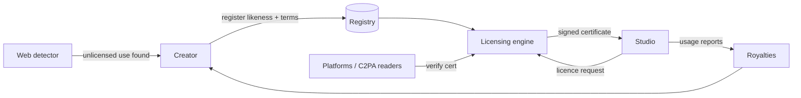

# Architecture — likeness-license

## 1. Scope
Registry and licensing engine for people's faces and voices used in AI-generated content.
**MVP:** fingerprint registry (SHA-256 of media), owner terms (uses, territories, duration,
exclusivity, prohibitions, pricing), licence issuance with conflict checks, HMAC-signed
certificates, verification, revocation, usage reporting and royalty statements.
**Product:** perceptual and voice embeddings for detection, C2PA embedding, agency rosters and payout splits.

## 2. System context

Note: the Detector and C2PA readers in this diagram are roadmap, not shipped in this release.

## 3. Issuance checks (in order)
Owner exists → use allowed → no prohibited purpose tags → territory allowed → duration ≤ max →
exclusivity offered (if requested) → **no overlap with an exclusive licence** (or, if this request
is exclusive, with any licence) for the same use. The fee is `flat_fee[use] × days/365 × exclusivity multiplier`.

## 4. Design decisions
- **Hard prohibitions are owner-set and non-overridable** (political, adult, endorsement,
  deceased impersonation). Safety and consent are encoded in the engine, not in contracts alone.
- **Certificates are self-contained signed payloads.** A platform can verify offline. Revocation is
  checked online (short-lived certificates plus a revocation list in the product).
- **Fingerprints, not media.** Creators can register without uploading raw likeness data.
  *Trade-off:* exact hashes don't detect derivatives, so the product adds perceptual face and
  voice embeddings stored as irreversible templates.

## 5. Future production architecture (not shipped)
An Ed25519 signing service (KMS-held keys, JWKS published), Postgres (owners, terms versions,
licences, usage, statements), a C2PA manifest writer for licensees, a detection crawler with an
embedding index, and Stripe Connect payouts. None of this is in this release: this release is the
fingerprint registry, terms engine, HMAC-signed certificates, verification, revocation, usage
reporting and royalty statements described in §1.

## 6. Risks
Right-of-publicity law varies by jurisdiction, so territory-aware terms templates need legal
review. Identity verification of registrants (KYC plus liveness) prevents someone registering
another person's face.
